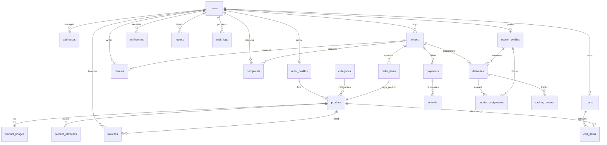

# The Agency — Database Design Specification

This document defines the authoritative database design for **The Agency** marketplace platform. The primary database is **PostgreSQL**, leveraging explicit constraints, relation constraints, robust indexing, and transaction-safe isolation.

---

## 1. Entity Relationship Diagram (ERD)

The following diagram illustrates the relationships and cardinalities between the database tables.



---

## 2. Table Specifications & Constraints

### 2.1 Core Identity

#### `users`
Represents platform members. A user can act as both buyer, seller, and courier.
*   **Columns:**
    *   `id` `UUID` `PRIMARY KEY` (default: `gen_random_uuid()`)
    *   `email` `VARCHAR(255)` `NOT NULL`
    *   `normalized_email` `VARCHAR(255)` `NOT NULL` (Lowercase representation for matching)
    *   `phone` `VARCHAR(50)` `NULL`
    *   `password_hash` `VARCHAR(255)` `NOT NULL`
    *   `display_name` `VARCHAR(100)` `NOT NULL`
    *   `role` `VARCHAR(20)` `NOT NULL`
    *   `status` `VARCHAR(30)` `NOT NULL`
    *   `created_at` `TIMESTAMPTZ` `NOT NULL` (default: `CURRENT_TIMESTAMP`)
    *   `updated_at` `TIMESTAMPTZ` `NOT NULL` (default: `CURRENT_TIMESTAMP`)
    *   `email_verified_at` `TIMESTAMPTZ` `NULL`
*   **Constraints:**
    *   `uq_users_normalized_email` `UNIQUE (normalized_email)`
    *   `chk_users_role` `CHECK (role IN ('USER', 'ADMIN', 'MODERATOR'))`
    *   `chk_users_status` `CHECK (status IN ('PENDING_VERIFICATION', 'ACTIVE', 'SUSPENDED', 'DELETED'))`

#### `addresses`
Shipping and pickup addresses. Private user details are protected.
*   **Columns:**
    *   `id` `UUID` `PRIMARY KEY` (default: `gen_random_uuid()`)
    *   `user_id` `UUID` `NOT NULL` `REFERENCES users(id) ON DELETE CASCADE`
    *   `label` `VARCHAR(50)` `NOT NULL` (e.g., 'Home', 'Work', 'Storefront')
    *   `recipient_name` `VARCHAR(100)` `NOT NULL`
    *   `phone` `VARCHAR(50)` `NOT NULL`
    *   `address_line_1` `VARCHAR(255)` `NOT NULL`
    *   `address_line_2` `VARCHAR(255)` `NULL`
    *   `city` `VARCHAR(100)` `NOT NULL`
    *   `district` `VARCHAR(100)` `NOT NULL` (Operational delivery zone mapping)
    *   `postal_code` `VARCHAR(20)` `NULL`
    *   `is_default` `BOOLEAN` `NOT NULL` (default: `false`)
    *   `created_at` `TIMESTAMPTZ` `NOT NULL` (default: `CURRENT_TIMESTAMP`)
    *   `updated_at` `TIMESTAMPTZ` `NOT NULL` (default: `CURRENT_TIMESTAMP`)

#### `seller_profiles`
Profile extending a standard user account to permit selling items.
*   **Columns:**
    *   `id` `UUID` `PRIMARY KEY` `REFERENCES users(id) ON DELETE CASCADE`
    *   `bio` `TEXT` `NULL`
    *   `verification_status` `VARCHAR(20)` `NOT NULL`
    *   `verified_at` `TIMESTAMPTZ` `NULL`
    *   `rating_avg` `NUMERIC(3, 2)` `NOT NULL` (default: `0.00`)
    *   `rating_count` `INT` `NOT NULL` (default: `0`)
    *   `created_at` `TIMESTAMPTZ` `NOT NULL` (default: `CURRENT_TIMESTAMP`)
    *   `updated_at` `TIMESTAMPTZ` `NOT NULL` (default: `CURRENT_TIMESTAMP`)
*   **Constraints:**
    *   `chk_seller_verification_status` `CHECK (verification_status IN ('UNVERIFIED', 'PENDING', 'VERIFIED', 'REJECTED'))`

#### `courier_profiles`
Profile extending a standard user account to permit executing deliveries.
*   **Columns:**
    *   `id` `UUID` `PRIMARY KEY` `REFERENCES users(id) ON DELETE CASCADE`
    *   `vehicle_type` `VARCHAR(30)` `NOT NULL`
    *   `license_number` `VARCHAR(50)` `NULL`
    *   `availability_status` `VARCHAR(20)` `NOT NULL`
    *   `current_zone` `VARCHAR(100)` `NULL`
    *   `rating_avg` `NUMERIC(3, 2)` `NOT NULL` (default: `0.00`)
    *   `rating_count` `INT` `NOT NULL` (default: `0`)
    *   `created_at` `TIMESTAMPTZ` `NOT NULL` (default: `CURRENT_TIMESTAMP`)
    *   `updated_at` `TIMESTAMPTZ` `NOT NULL` (default: `CURRENT_TIMESTAMP`)
*   **Constraints:**
    *   `chk_courier_vehicle_type` `CHECK (vehicle_type IN ('BICYCLE', 'MOTORCYCLE', 'CAR', 'VAN'))`
    *   `chk_courier_availability_status` `CHECK (availability_status IN ('OFFLINE', 'ONLINE', 'BUSY'))`

---

### 2.2 Marketplace & Products

#### `categories`
Hierarchical catalog groupings.
*   **Columns:**
    *   `id` `UUID` `PRIMARY KEY` (default: `gen_random_uuid()`)
    *   `parent_id` `UUID` `NULL` `REFERENCES categories(id) ON DELETE RESTRICT`
    *   `name` `VARCHAR(100)` `NOT NULL`
    *   `slug` `VARCHAR(100)` `NOT NULL`
    *   `description` `TEXT` `NULL`
    *   `created_at` `TIMESTAMPTZ` `NOT NULL` (default: `CURRENT_TIMESTAMP`)
    *   `updated_at` `TIMESTAMPTZ` `NOT NULL` (default: `CURRENT_TIMESTAMP`)
*   **Constraints:**
    *   `uq_categories_slug` `UNIQUE (slug)`

#### `products`
The core item listings. Second-hand products are unique listings (quantity = 1).
*   **Columns:**
    *   `id` `UUID` `PRIMARY KEY` (default: `gen_random_uuid()`)
    *   `seller_id` `UUID` `NOT NULL` `REFERENCES seller_profiles(id) ON DELETE RESTRICT`
    *   `category_id` `UUID` `NOT NULL` `REFERENCES categories(id) ON DELETE RESTRICT`
    *   `title` `VARCHAR(255)` `NOT NULL`
    *   `description` `TEXT` `NOT NULL`
    *   `price` `NUMERIC(12, 2)` `NOT NULL`
    *   `currency` `VARCHAR(3)` `NOT NULL` (default: `'EGP'`)
    *   `condition` `VARCHAR(30)` `NOT NULL`
    *   `status` `VARCHAR(20)` `NOT NULL`
    *   `version` `INT` `NOT NULL` (default: `1`)
    *   `created_at` `TIMESTAMPTZ` `NOT NULL` (default: `CURRENT_TIMESTAMP`)
    *   `updated_at` `TIMESTAMPTZ` `NOT NULL` (default: `CURRENT_TIMESTAMP`)
    *   `published_at` `TIMESTAMPTZ` `NULL`
*   **Constraints:**
    *   `chk_products_price` `CHECK (price >= 0.00)`
    *   `chk_products_status` `CHECK (status IN ('DRAFT', 'PUBLISHED', 'RESERVED', 'SOLD', 'CANCELLED', 'REJECTED', 'REMOVED'))`
    *   `chk_products_condition` `CHECK (condition IN ('NEW_WITH_TAGS', 'NEW_WITHOUT_TAGS', 'VERY_GOOD', 'GOOD', 'SATISFACTORY'))`

#### `product_images`
Metadata pointing to image storage targets. Image binary payloads are not stored in the database.
*   **Columns:**
    *   `id` `UUID` `PRIMARY KEY` (default: `gen_random_uuid()`)
    *   `product_id` `UUID` `NOT NULL` `REFERENCES products(id) ON DELETE CASCADE`
    *   `object_key` `VARCHAR(255)` `NOT NULL`
    *   `url` `VARCHAR(2048)` `NOT NULL`
    *   `sort_order` `INT` `NOT NULL` (default: `0`)
    *   `width` `INT` `NULL`
    *   `height` `INT` `NULL`
    *   `mime_type` `VARCHAR(100)` `NULL`
    *   `created_at` `TIMESTAMPTZ` `NOT NULL` (default: `CURRENT_TIMESTAMP`)

#### `product_attributes`
Flexible tags defining clothing parameters (size, brand, color, gender).
*   **Columns:**
    *   `id` `UUID` `PRIMARY KEY` (default: `gen_random_uuid()`)
    *   `product_id` `UUID` `NOT NULL` `REFERENCES products(id) ON DELETE CASCADE`
    *   `attribute_key` `VARCHAR(50)` `NOT NULL` (e.g. 'size', 'brand', 'color')
    *   `attribute_value` `VARCHAR(255)` `NOT NULL`
    *   `created_at` `TIMESTAMPTZ` `NOT NULL` (default: `CURRENT_TIMESTAMP`)
*   **Constraints:**
    *   `uq_product_attributes_key_val` `UNIQUE (product_id, attribute_key)`

#### `favorites`
Tracks bookmarked products for buyers.
*   **Columns:**
    *   `user_id` `UUID` `NOT NULL` `REFERENCES users(id) ON DELETE CASCADE`
    *   `product_id` `UUID` `NOT NULL` `REFERENCES products(id) ON DELETE CASCADE`
    *   `created_at` `TIMESTAMPTZ` `NOT NULL` (default: `CURRENT_TIMESTAMP`)
*   **Constraints:**
    *   `pk_favorites` `PRIMARY KEY (user_id, product_id)`

---

### 2.3 Cart & Shopping

#### `carts`
User shopping carts.
*   **Columns:**
    *   `id` `UUID` `PRIMARY KEY` (default: `gen_random_uuid()`)
    *   `user_id` `UUID` `NOT NULL` `REFERENCES users(id) ON DELETE CASCADE`
    *   `created_at` `TIMESTAMPTZ` `NOT NULL` (default: `CURRENT_TIMESTAMP`)
    *   `updated_at` `TIMESTAMPTZ` `NOT NULL` (default: `CURRENT_TIMESTAMP`)
*   **Constraints:**
    *   `uq_carts_user_id` `UNIQUE (user_id)`

#### `cart_items`
Contains specific products in the cart.
*   **Columns:**
    *   `id` `UUID` `PRIMARY KEY` (default: `gen_random_uuid()`)
    *   `cart_id` `UUID` `NOT NULL` `REFERENCES carts(id) ON DELETE CASCADE`
    *   `product_id` `UUID` `NOT NULL` `REFERENCES products(id) ON DELETE CASCADE`
    *   `created_at` `TIMESTAMPTZ` `NOT NULL` (default: `CURRENT_TIMESTAMP`)
*   **Constraints:**
    *   `uq_cart_items_cart_product` `UNIQUE (cart_id, product_id)`
    *   `uq_cart_items_product_id` `UNIQUE (product_id)` (A unique second-hand product cannot exist in multiple carts concurrently)

---

### 2.4 Orders & Checkout

#### `orders`
Buyer purchases. Tracks transaction state, values, and expiration rules.
*   **Columns:**
    *   `id` `UUID` `PRIMARY KEY` (default: `gen_random_uuid()`)
    *   `buyer_id` `UUID` `NOT NULL` `REFERENCES users(id) ON DELETE RESTRICT`
    *   `shipping_address_id` `UUID` `NOT NULL` `REFERENCES addresses(id) ON DELETE RESTRICT`
    *   `shipping_address_snapshot` `JSONB` `NOT NULL` (Ensures historical address accuracy regardless of subsequent edits)
    *   `subtotal` `NUMERIC(12, 2)` `NOT NULL`
    *   `delivery_fee` `NUMERIC(12, 2)` `NOT NULL`
    *   `total` `NUMERIC(12, 2)` `NOT NULL`
    *   `currency` `VARCHAR(3)` `NOT NULL` (default: `'EGP'`)
    *   `status` `VARCHAR(30)` `NOT NULL`
    *   `idempotency_key` `VARCHAR(255)` `NULL`
    *   `version` `INT` `NOT NULL` (default: `1`)
    *   `created_at` `TIMESTAMPTZ` `NOT NULL` (default: `CURRENT_TIMESTAMP`)
    *   `updated_at` `TIMESTAMPTZ` `NOT NULL` (default: `CURRENT_TIMESTAMP`)
    *   `reservation_expires_at` `TIMESTAMPTZ` `NULL` (Expiration for paying for locked items)
*   **Constraints:**
    *   `uq_orders_idempotency_key` `UNIQUE (idempotency_key)`
    *   `chk_orders_status` `CHECK (status IN ('CREATED', 'PAYMENT_PENDING', 'PAID', 'READY_FOR_PICKUP', 'COURIER_ASSIGNED', 'PICKED_UP', 'OUT_FOR_DELIVERY', 'DELIVERED', 'CANCELLED', 'FAILED_DELIVERY', 'RETURN_REQUESTED', 'RETURNED'))`
    *   `chk_orders_subtotal` `CHECK (subtotal >= 0.00)`
    *   `chk_orders_delivery_fee` `CHECK (delivery_fee >= 0.00)`
    *   `chk_orders_total` `CHECK (total = subtotal + delivery_fee)`

#### `order_items`
References specific products purchased within an order.
*   **Columns:**
    *   `id` `UUID` `PRIMARY KEY` (default: `gen_random_uuid()`)
    *   `order_id` `UUID` `NOT NULL` `REFERENCES orders(id) ON DELETE CASCADE`
    *   `product_id` `UUID` `NOT NULL` `REFERENCES products(id) ON DELETE RESTRICT`
    *   `seller_id` `UUID` `NOT NULL` `REFERENCES seller_profiles(id) ON DELETE RESTRICT`
    *   `unit_price` `NUMERIC(12, 2)` `NOT NULL`
    *   `quantity` `INT` `NOT NULL` (default: `1`)
    *   `subtotal` `NUMERIC(12, 2)` `NOT NULL`
*   **Constraints:**
    *   `uq_order_items_product_id` `UNIQUE (product_id)` (Guarantees a product is only sold in exactly one order transaction)
    *   `chk_order_items_quantity` `CHECK (quantity = 1)` (Second-hand clothing items are single-item inventory only)
    *   `chk_order_items_unit_price` `CHECK (unit_price >= 0.00)`
    *   `chk_order_items_subtotal` `CHECK (subtotal = unit_price * quantity)`

---

### 2.5 Payments

#### `payments`
Details payment gateway interactions.
*   **Columns:**
    *   `id` `UUID` `PRIMARY KEY` (default: `gen_random_uuid()`)
    *   `order_id` `UUID` `NOT NULL` `REFERENCES orders(id) ON DELETE RESTRICT`
    *   `provider` `VARCHAR(50)` `NOT NULL` (e.g. 'STRIPE', 'MOCK')
    *   `provider_payment_id` `VARCHAR(255)` `NOT NULL`
    *   `amount` `NUMERIC(12, 2)` `NOT NULL`
    *   `currency` `VARCHAR(3)` `NOT NULL` (default: `'EGP'`)
    *   `status` `VARCHAR(20)` `NOT NULL`
    *   `created_at` `TIMESTAMPTZ` `NOT NULL` (default: `CURRENT_TIMESTAMP`)
    *   `updated_at` `TIMESTAMPTZ` `NOT NULL` (default: `CURRENT_TIMESTAMP`)
*   **Constraints:**
    *   `uq_payments_provider_id` `UNIQUE (provider_payment_id)`
    *   `chk_payments_status` `CHECK (status IN ('PENDING', 'COMPLETED', 'FAILED', 'REFUNDED'))`
    *   `chk_payments_amount` `CHECK (amount >= 0.00)`

#### `refunds`
Reimbursements to buyers.
*   **Columns:**
    *   `id` `UUID` `PRIMARY KEY` (default: `gen_random_uuid()`)
    *   `payment_id` `UUID` `NOT NULL` `REFERENCES payments(id) ON DELETE RESTRICT`
    *   `provider_refund_id` `VARCHAR(255)` `NOT NULL`
    *   `amount` `NUMERIC(12, 2)` `NOT NULL`
    *   `currency` `VARCHAR(3)` `NOT NULL` (default: `'EGP'`)
    *   `status` `VARCHAR(20)` `NOT NULL`
    *   `reason` `TEXT` `NULL`
    *   `created_at` `TIMESTAMPTZ` `NOT NULL` (default: `CURRENT_TIMESTAMP`)
    *   `updated_at` `TIMESTAMPTZ` `NOT NULL` (default: `CURRENT_TIMESTAMP`)
*   **Constraints:**
    *   `uq_refunds_provider_id` `UNIQUE (provider_refund_id)`
    *   `chk_refunds_status` `CHECK (status IN ('PENDING', 'COMPLETED', 'FAILED'))`
    *   `chk_refunds_amount` `CHECK (amount >= 0.00)`

---

### 2.6 Delivery

#### `deliveries`
The delivery task associated with a completed paid order.
*   **Columns:**
    *   `id` `UUID` `PRIMARY KEY` (default: `gen_random_uuid()`)
    *   `order_id` `UUID` `NOT NULL` `REFERENCES orders(id) ON DELETE RESTRICT`
    *   `status` `VARCHAR(30)` `NOT NULL`
    *   `pickup_address_snapshot` `JSONB` `NOT NULL` (Snapshot of seller details at assignment)
    *   `delivery_address_snapshot` `JSONB` `NOT NULL` (Snapshot of buyer details at assignment)
    *   `assigned_courier_id` `UUID` `NULL` `REFERENCES courier_profiles(id) ON DELETE RESTRICT`
    *   `created_at` `TIMESTAMPTZ` `NOT NULL` (default: `CURRENT_TIMESTAMP`)
    *   `updated_at` `TIMESTAMPTZ` `NOT NULL` (default: `CURRENT_TIMESTAMP`)
    *   `assigned_at` `TIMESTAMPTZ` `NULL`
    *   `picked_up_at` `TIMESTAMPTZ` `NULL`
    *   `delivered_at` `TIMESTAMPTZ` `NULL`
    *   `failed_at` `TIMESTAMPTZ` `NULL`
    *   `failure_reason` `TEXT` `NULL`
*   **Constraints:**
    *   `uq_deliveries_order_id` `UNIQUE (order_id)`
    *   `chk_deliveries_status` `CHECK (status IN ('PENDING_ASSIGNMENT', 'ASSIGNED', 'PICKING_UP', 'OUT_FOR_DELIVERY', 'DELIVERED', 'FAILED', 'CANCELLED'))`

#### `courier_assignments`
Dispatches offered to couriers.
*   **Columns:**
    *   `id` `UUID` `PRIMARY KEY` (default: `gen_random_uuid()`)
    *   `delivery_id` `UUID` `NOT NULL` `REFERENCES deliveries(id) ON DELETE CASCADE`
    *   `courier_id` `UUID` `NOT NULL` `REFERENCES courier_profiles(id) ON DELETE RESTRICT`
    *   `status` `VARCHAR(20)` `NOT NULL`
    *   `offered_at` `TIMESTAMPTZ` `NOT NULL` (default: `CURRENT_TIMESTAMP`)
    *   `decided_at` `TIMESTAMPTZ` `NULL`
    *   `expires_at` `TIMESTAMPTZ` `NOT NULL`
*   **Constraints:**
    *   `chk_courier_assignments_status` `CHECK (status IN ('OFFERED', 'ACCEPTED', 'REJECTED', 'EXPIRED'))`

#### `tracking_events`
Audit path of shipping milestones.
*   **Columns:**
    *   `id` `UUID` `PRIMARY KEY` (default: `gen_random_uuid()`)
    *   `delivery_id` `UUID` `NOT NULL` `REFERENCES deliveries(id) ON DELETE CASCADE`
    *   `event_type` `VARCHAR(50)` `NOT NULL` (e.g. 'CREATED', 'COURIER_ASSIGNED', 'PICKED_UP', 'OUT_FOR_DELIVERY', 'DELIVERY_COMPLETED', 'DELIVERY_FAILED')
    *   `actor_id` `UUID` `NOT NULL` `REFERENCES users(id) ON DELETE RESTRICT`
    *   `latitude` `NUMERIC(9, 6)` `NULL`
    *   `longitude` `NUMERIC(9, 6)` `NULL`
    *   `metadata` `JSONB` `NULL`
    *   `created_at` `TIMESTAMPTZ` `NOT NULL` (default: `CURRENT_TIMESTAMP`)

---

### 2.7 Reviews & Interactions

#### `reviews`
Post-purchase quality reviews. Linked to legitimate completed transactions.
*   **Columns:**
    *   `id` `UUID` `PRIMARY KEY` (default: `gen_random_uuid()`)
    *   `order_id` `UUID` `NOT NULL` `REFERENCES orders(id) ON DELETE RESTRICT`
    *   `reviewer_id` `UUID` `NOT NULL` `REFERENCES users(id) ON DELETE RESTRICT`
    *   `target_type` `VARCHAR(20)` `NOT NULL`
    *   `target_user_id` `UUID` `NOT NULL` `REFERENCES users(id) ON DELETE RESTRICT`
    *   `rating` `INT` `NOT NULL`
    *   `content` `TEXT` `NULL`
    *   `created_at` `TIMESTAMPTZ` `NOT NULL` (default: `CURRENT_TIMESTAMP`)
*   **Constraints:**
    *   `uq_reviews_order_reviewer_target` `UNIQUE (order_id, reviewer_id, target_type)`
    *   `chk_reviews_target_type` `CHECK (target_type IN ('SELLER', 'COURIER'))`
    *   `chk_reviews_rating` `CHECK (rating BETWEEN 1 AND 5)`

#### `notifications`
In-app communication records.
*   **Columns:**
    *   `id` `UUID` `PRIMARY KEY` (default: `gen_random_uuid()`)
    *   `user_id` `UUID` `NOT NULL` `REFERENCES users(id) ON DELETE CASCADE`
    *   `title` `VARCHAR(255)` `NOT NULL`
    *   `content` `TEXT` `NOT NULL`
    *   `type` `VARCHAR(50)` `NOT NULL` (e.g., 'ORDER_STATUS', 'PAYMENT', 'DELIVERY', 'SYSTEM')
    *   `is_read` `BOOLEAN` `NOT NULL` (default: `false`)
    *   `created_at` `TIMESTAMPTZ` `NOT NULL` (default: `CURRENT_TIMESTAMP`)
    *   `read_at` `TIMESTAMPTZ` `NULL`

---

### 2.8 Moderation, Support & Audits

#### `reports`
User flag logs (e.g. offensive listings, scam users).
*   **Columns:**
    *   `id` `UUID` `PRIMARY KEY` (default: `gen_random_uuid()`)
    *   `reporter_id` `UUID` `NOT NULL` `REFERENCES users(id) ON DELETE RESTRICT`
    *   `reported_user_id` `UUID` `NULL` `REFERENCES users(id) ON DELETE RESTRICT`
    *   `reported_product_id` `UUID` `NULL` `REFERENCES products(id) ON DELETE RESTRICT`
    *   `reason` `VARCHAR(100)` `NOT NULL`
    *   `description` `TEXT` `NULL`
    *   `status` `VARCHAR(20)` `NOT NULL`
    *   `resolution_notes` `TEXT` `NULL`
    *   `created_at` `TIMESTAMPTZ` `NOT NULL` (default: `CURRENT_TIMESTAMP`)
    *   `updated_at` `TIMESTAMPTZ` `NOT NULL` (default: `CURRENT_TIMESTAMP`)
*   **Constraints:**
    *   `chk_reports_status` `CHECK (status IN ('PENDING', 'INVESTIGATING', 'RESOLVED', 'DISMISSED'))`
    *   `chk_reports_has_target` `CHECK (reported_user_id IS NOT NULL OR reported_product_id IS NOT NULL)`

#### `complaints`
Disputes linked to order transactions.
*   **Columns:**
    *   `id` `UUID` `PRIMARY KEY` (default: `gen_random_uuid()`)
    *   `order_id` `UUID` `NOT NULL` `REFERENCES orders(id) ON DELETE RESTRICT`
    *   `complainant_id` `UUID` `NOT NULL` `REFERENCES users(id) ON DELETE RESTRICT`
    *   `subject` `VARCHAR(255)` `NOT NULL`
    *   `description` `TEXT` `NOT NULL`
    *   `status` `VARCHAR(20)` `NOT NULL`
    *   `resolution` `TEXT` `NULL`
    *   `created_at` `TIMESTAMPTZ` `NOT NULL` (default: `CURRENT_TIMESTAMP`)
    *   `updated_at` `TIMESTAMPTZ` `NOT NULL` (default: `CURRENT_TIMESTAMP`)
*   **Constraints:**
    *   `chk_complaints_status` `CHECK (status IN ('OPEN', 'UNDER_REVIEW', 'RESOLVED', 'CLOSED'))`

#### `audit_logs`
Chronological operational records. Employs `BIGSERIAL` sequence indexing for fast sequential writes.
*   **Columns:**
    *   `id` `BIGSERIAL` `PRIMARY KEY`
    *   `actor_id` `UUID` `NULL` `REFERENCES users(id) ON DELETE RESTRICT`
    *   `action` `VARCHAR(100)` `NOT NULL`
    *   `resource_type` `VARCHAR(50)` `NOT NULL`
    *   `resource_id` `VARCHAR(255)` `NULL`
    *   `result` `VARCHAR(20)` `NOT NULL`
    *   `old_values` `JSONB` `NULL`
    *   `new_values` `JSONB` `NULL`
    *   `ip_address` `VARCHAR(45)` `NULL`
    *   `user_agent` `VARCHAR(512)` `NULL`
    *   `correlation_id` `UUID` `NULL`
    *   `created_at` `TIMESTAMPTZ` `NOT NULL` (default: `CURRENT_TIMESTAMP`)
*   **Constraints:**
    *   `chk_audit_logs_result` `CHECK (result IN ('SUCCESS', 'FAILURE'))`

---

## 3. Indexing Strategy

To support high-performance lookups, key foreign key relationships and status filters are indexed explicitly.

```sql
-- Identity & Addresses
CREATE INDEX idx_addresses_user_id ON addresses(user_id);

-- Products & Catalog
CREATE INDEX idx_products_seller_id_status ON products(seller_id, status);
CREATE INDEX idx_products_category_id_status ON products(category_id, status);
CREATE INDEX idx_products_status_published ON products(status, published_at) WHERE status = 'PUBLISHED';
CREATE INDEX idx_product_images_product_id ON product_images(product_id);
CREATE INDEX idx_product_attributes_product_id ON product_attributes(product_id);

-- Carts
CREATE INDEX idx_cart_items_cart_id ON cart_items(cart_id);

-- Orders
CREATE INDEX idx_orders_buyer_id_created ON orders(buyer_id, created_at DESC);
CREATE INDEX idx_orders_status_created ON orders(status, created_at DESC);
CREATE INDEX idx_orders_reservation_expiry ON orders(reservation_expires_at) WHERE status = 'CREATED';
CREATE INDEX idx_order_items_order_id ON order_items(order_id);

-- Payments
CREATE INDEX idx_payments_order_id ON payments(order_id);

-- Deliveries & Tracking
CREATE INDEX idx_deliveries_courier_status ON deliveries(assigned_courier_id, status);
CREATE INDEX idx_courier_assignments_delivery_id ON courier_assignments(delivery_id);
CREATE INDEX idx_courier_assignments_courier_id_status ON courier_assignments(courier_id, status);
CREATE INDEX idx_tracking_events_delivery_id_created ON tracking_events(delivery_id, created_at DESC);

-- Notifications
CREATE INDEX idx_notifications_user_read ON notifications(user_id, is_read) WHERE is_read = FALSE;

-- Reviews
CREATE INDEX idx_reviews_target_user ON reviews(target_user_id, rating);
```

---

## 4. Concurrency Management

### 4.1 Product Locking (Preventing Double-Sales)
Since second-hand clothing items are unique resources (Quantity = 1), the system must guarantee that a product is never reserved or purchased by two checkout flows concurrently.
1.  **Strict Unique Constraints:** The `uq_order_items_product_id` and `uq_cart_items_product_id` constraints act as the absolute database-level safeguards. Any concurrent insert of the same product ID into these tables will fail immediately.
2.  **Row Locking (Pessimistic Locking):** During checkout validation, the application executes a `SELECT FOR UPDATE` query on the target product row:
    ```sql
    SELECT id, price, status, version FROM products 
    WHERE id = :productId AND status = 'PUBLISHED' 
    FOR UPDATE;
    ```
    This lock blocks concurrent checkouts for the same product, releasing only when the order creation transaction commits or rolls back.

### 4.2 Optimistic Concurrency Control
For non-inventory resources (e.g., updating order status, processing courier assignments, or editing seller profiles), we use Optimistic Concurrency Control (OCC) via the `version` integer columns:
*   Every update query compares and increments the `version` field:
    ```sql
    UPDATE products 
    SET status = 'RESERVED', version = version + 1, updated_at = CURRENT_TIMESTAMP
    WHERE id = :productId AND version = :expectedVersion;
    ```
*   If the row count returned is `0`, a concurrency exception is thrown, prompting the application to retry or abort.

### 4.3 Courier Assignment Locking
To prevent multiple couriers from accepting the same delivery concurrently:
*   A pessimistic lock is applied to the delivery row:
    ```sql
    SELECT id, status, assigned_courier_id FROM deliveries 
    WHERE id = :deliveryId FOR UPDATE;
    ```
*   The transaction validates that the status is `PENDING_ASSIGNMENT` and `assigned_courier_id` is null before setting the values and committing.

---

## 5. Audit & Compliance Requirements

1.  **Administrative Actions Auditing:** Any state-changing actions performed by an admin or moderator (such as suspending users, deleting products, or resolving reports) must insert a record into the `audit_logs` table.
2.  **Sensitive Information Protection:** Raw passwords, credit card numbers, payment access tokens, or refresh tokens must **never** be logged in the `audit_logs` table or the application logs.
3.  **Traceability via Correlation IDs:** Each web request initiates with an HTTP Header `X-Correlation-ID` (or generates a new UUID if missing). This correlation ID is carried into `audit_logs` and OpenTelemetry structured application logs, ensuring complete request traceability.
4.  **Immutable History snaps:** Addresses are copied inside the `shipping_address_snapshot`, `pickup_address_snapshot`, and `delivery_address_snapshot` tables. This guarantees that historical records remain intact even if a user edits their address or profile in the future.

---

## 6. Critical Database Transactions

### 6.1 Order Creation & Product Reservation
Executed inside a single database transaction set to `ISOLATION LEVEL READ COMMITTED`.

```sql
BEGIN;

-- 1. Lock and fetch target product to verify availability
SELECT price, status 
FROM products 
WHERE id = :productId AND status = 'PUBLISHED' 
FOR UPDATE;

-- 2. Insert order
INSERT INTO orders (id, buyer_id, shipping_address_id, shipping_address_snapshot, subtotal, delivery_fee, total, status, reservation_expires_at)
VALUES (:orderId, :buyerId, :addressId, :addressSnapshotJson, :subtotal, :deliveryFee, :total, 'CREATED', :expiryTime);

-- 3. Insert order item (will fail if product is already in uq_order_items_product_id)
INSERT INTO order_items (id, order_id, product_id, seller_id, unit_price, quantity, subtotal)
VALUES (:itemId, :orderId, :productId, :sellerId, :price, 1, :price);

-- 4. Transition product status to RESERVED
UPDATE products 
SET status = 'RESERVED', updated_at = CURRENT_TIMESTAMP 
WHERE id = :productId;

-- 5. Clear product from all carts
DELETE FROM cart_items WHERE product_id = :productId;

COMMIT;
```

### 6.2 Payment Webhook Processing
Webhook execution from Stripe/payment providers must be idempotent and database-consistent.

```sql
BEGIN;

-- 1. Deduplicate by checking if the payment transaction was already processed
SELECT status FROM payments 
WHERE provider_payment_id = :providerPaymentId 
FOR UPDATE;

-- 2. If status is already COMPLETED, commit immediately and do nothing (idempotence)

-- 3. Update payment status to COMPLETED
UPDATE payments 
SET status = 'COMPLETED', updated_at = CURRENT_TIMESTAMP 
WHERE provider_payment_id = :providerPaymentId;

-- 4. Transition order status from PAYMENT_PENDING to PAID
UPDATE orders 
SET status = 'PAID', updated_at = CURRENT_TIMESTAMP 
WHERE id = :orderId;

-- 5. Transition product status to SOLD
UPDATE products 
SET status = 'SOLD', updated_at = CURRENT_TIMESTAMP 
WHERE id = (SELECT product_id FROM order_items WHERE order_id = :orderId);

-- 6. Initialize delivery record
INSERT INTO deliveries (id, order_id, status, pickup_address_snapshot, delivery_address_snapshot)
VALUES (:deliveryId, :orderId, 'PENDING_ASSIGNMENT', :pickupSnapshotJson, :deliverySnapshotJson);

COMMIT;
```

### 6.3 Courier Assignment Acceptance
Ensures only one courier can successfully accept an assignment.

```sql
BEGIN;

-- 1. Lock the delivery record
SELECT status, assigned_courier_id 
FROM deliveries 
WHERE id = :deliveryId 
FOR UPDATE;

-- 2. Validate state: status must be PENDING_ASSIGNMENT and assigned_courier_id must be NULL. 
-- If invalid, rollback and return error (already accepted by another courier).

-- 3. Update delivery record
UPDATE deliveries 
SET status = 'ASSIGNED', assigned_courier_id = :courierId, assigned_at = CURRENT_TIMESTAMP, updated_at = CURRENT_TIMESTAMP 
WHERE id = :deliveryId;

-- 4. Update the specific courier assignment offer status to ACCEPTED
UPDATE courier_assignments 
SET status = 'ACCEPTED', decided_at = CURRENT_TIMESTAMP 
WHERE delivery_id = :deliveryId AND courier_id = :courierId;

-- 5. Expire/Reject all other outstanding courier offers for this delivery
UPDATE courier_assignments 
SET status = 'EXPIRED', decided_at = CURRENT_TIMESTAMP 
WHERE delivery_id = :deliveryId AND courier_id != :courierId AND status = 'OFFERED';

-- 6. Log tracking milestone event
INSERT INTO tracking_events (id, delivery_id, event_type, actor_id, created_at)
VALUES (:eventId, :deliveryId, 'COURIER_ASSIGNED', :courierId, CURRENT_TIMESTAMP);

-- 7. Update order status to COURIER_ASSIGNED
UPDATE orders 
SET status = 'COURIER_ASSIGNED', updated_at = CURRENT_TIMESTAMP 
WHERE id = :orderId;

COMMIT;
```
